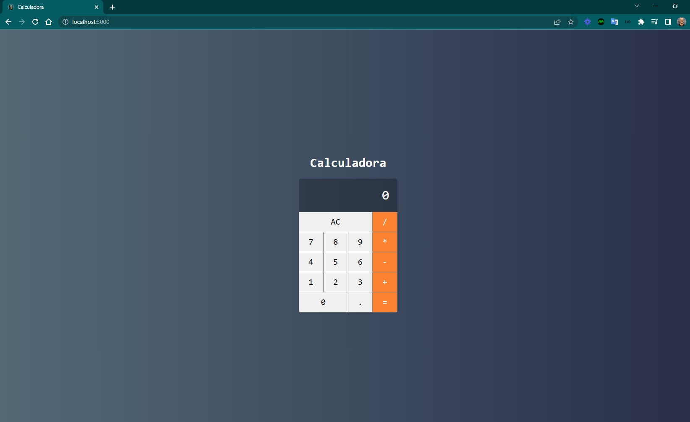

<h4 align="center"> 
  Calculadora - React.js
</h4>   

<p align="center" style="display: flex; align-items: flex-start; justify-content: center;"> 
   
</p> 

## 🎯 Visão do Produto
Desenvolvimento de uma calculadora web responsiva com forte foco em experiência de usuário (UX). O projeto evoluiu de um componente isolado para uma Single Page Application (SPA) profissional, incorporando um design system moderno com cabeçalho, rodapé e sistema dinâmico de troca de temas (*Theme Switcher* entre o Modo Vivo e o Modo Dark).

## 🏗️ Arquitetura e Engenharia de Software
- **Stack Tecnológica:** React.js, Vanilla CSS.
- **Padrões de Projeto (Design Patterns):**
  - **Componentização (Dumb vs Smart Components):** Separação clara entre componentes de apresentação estática (`Button`, `Display`, `Header`, `Footer`) e o componente de regra de negócio (`Calculator`, `App`).
  - **Single Source of Truth:** O estado da aplicação (valores numéricos, operação atual e o tema selecionado) é gerenciado de forma centralizada nos componentes pais.
  - **CSS Variables & Theming:** Utilização de variáveis customizadas do CSS (`--var`) controladas dinamicamente pelo estado do React para alternar paletas de cores, sombras e contrastes em tempo de execução.
- **Máquina de estados finita:** toda a regra de cálculo está em `src/core/calculator.js`, uma função pura `(estado, ação) → estado` usada com `useReducer`. Estados: `first`, `operator`, `second`, `result` e `error` (diagrama em [docs/ARQUITETURA.md](./docs/ARQUITETURA.md)).
- **Acessibilidade:** visor em `<output aria-live>`, teclas com nome falado ("Dividir", "Apagar último dígito"), foco visível, contraste WCAG AA nos dois temas e teclado físico completo.
- **Segurança (Tratamento de Débito Técnico):** A função nativa `eval()` foi totalmente removida e substituída por um parser matemático seguro baseado em estrutura de controle (`switch/case`), eliminando vulnerabilidades e o warning `no-eval` do ESLint.

## 💻 Plano de Ação & Roadmap Executado

### Fase 1: Fundação e MVP (Concluído)
- [x] 1. Inicialização do projeto (`create-react-app`) e limpeza estrutural.
- [x] 2. Estilização do Componente Calculator (`src/main/Calculator.jsx`).
- [x] 3. Estilização do Componente Button (`src/components/Button.jsx` e `src/components/Button.css`).
- [x] 4. Estilização do Componente Display (`src/components/Display.jsx`).
- [x] 5. Implementação da lógica base da calculadora.

### Fase 2: Segurança e Engenharia (Concluído)
- [x] 6. Refatoração da lógica de cálculo para eliminação do uso de `eval()`.

### Fase 3: Redesign, Layout SPA e UX (Concluído)
- [x] 7. Criação do estado global de temas (`App.jsx`) com alternância interativa.
- [x] 8. Desenvolvimento do componente `<Header />` com identidade visual e botão de *Theme Switcher*.
- [x] 9. Desenvolvimento do componente `<Footer />` com créditos e links de contato.
- [x] 10. Configuração do Design System em `index.css` com paletas dinâmicas para o **Modo Vivo** (contraste aprimorado, display destacado e detalhes em vermelho vivo inspirados em referências de alto padrão) e **Modo Dark** (gradientes profundos e botões estilizados).
- [x] 11. Estruturação global em Layout Flexbox (`column`) empilhando Header, Main e Footer perfeitamente.

### Fase 4: Máquina de Estados, Acessibilidade e Testes (Concluído em 27/09/2026)
- [x] 12. Máquina de estados finita pura (`src/core/calculator.js`): nova conta após "=", vírgula segura, troca de operador, "=" repetido e erro de divisão por zero.
- [x] 13. Teclado físico (números, `+ - * /`, Enter, Backspace, Esc) e tecla ⌫.
- [x] 14. Visor em português (vírgula decimal) com a expressão pendente ("12 ×").
- [x] 15. Acessibilidade WCAG 2.2 AA verificada com axe-core nos dois temas.
- [x] 16. Tema segue a preferência do sistema e fica salvo no navegador.
- [x] 17. Atualização para React 18 e react-scripts 5 (sem `--openssl-legacy-provider`).
- [x] 18. Testes unitários da máquina de estados e testes de interface.

## ▶️ Como executar

```bash
npm install
npm start                       # http://localhost:3000
npm test -- --watchAll=false    # 28 testes
npm run build                   # pasta build/ pronta para GitHub Pages ou Vercel (gratuitos)
```

## 🌐 Em produção

**Demonstração:** https://calculadora.onrender.com

- Site estático gratuito no Render (CDN, não hiberna), configurado em `render.yaml`: `npm ci && npm run build`, publicação de `./build`.
- Cada push na `main` gera um novo deploy.
- Passo a passo completo: [docs/DEPLOY.md](docs/DEPLOY.md).

## 📊 Estado do MVP & Documentação

| Documento | Conteúdo |
|---|---|
| [docs/ANALISE.md](./docs/ANALISE.md) | Requisitos, diagnóstico, rubrica e BDD |
| [docs/ARQUITETURA.md](./docs/ARQUITETURA.md) | C4, diagrama da máquina de estados, contrato de teclado e ADRs |
| [docs/PLANO-DE-ACAO.md](./docs/PLANO-DE-ACAO.md) | Tarefas priorizadas por MoSCoW |

| Momento | Nota MVP | Situação |
|---|---|---|
| Antes (27/09/2026) | 5,44 | Reprovado — vírgula após "=" quebrava a tela e divisão por zero mostrava 0 |
| Depois (27/09/2026) | 8,90 | Aprovado |
 
## 🚀 Tecnologias e Recursos
- Favicon personalizado
- Configuração de idioma e meta tags
- Fonte Google Roboto via link
- [Gradiente uiGradients](https://uigradients.com/#CitrusPeel) (Referência de base)
- Sistema dinâmico de Variáveis CSS
- Layout estruturado com **CSS Grid** (teclado) e **Flexbox** (estrutura da SPA)

## 🚀 Testes e Cobertura

Arquivos `src/core/calculator.test.js` (máquina de estados), `src/main/Calculator.test.js` (interface e teclado) e `src/App.test.js` (tema e layout).

### 🧪 Evidência de Cobertura de Testes

Os testes automatizados foram executados em ambiente isolado via Jest e React Testing Library. A suíte completa passou com 100% de sucesso em todas as verificações:

```text
PASS src/core/calculator.test.js
PASS src/main/Calculator.test.js
PASS src/App.test.js

Test Suites: 3 passed, 3 total
Tests:       28 passed, 28 total
```


## 📝 Licença
Este projeto está sob a licença MIT.

---
Feito com ❤️ por Douglas A B Novato 👋🏽 [Entre em contato!](https://www.linkedin.com/in/douglasabnovato/)
 
*Fonte original do projeto: Curso React + Redux (Cod3r).*