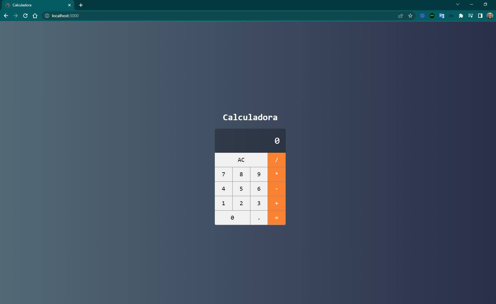

> **Projeto de estudo (N1).** Estado conferido em 16/11/2026: 9 de 10 critérios aplicáveis atendidos, MVP não finalizado: o 9 fica Parcial até os 21 alertas do Dependabot que restam terem correção ou decisão (#38). Detalhes em [docs/MVP.md](docs/MVP.md) e plano do ciclo em [docs/PLANO-DE-ACAO.md](docs/PLANO-DE-ACAO.md).

<h4 align="center"> 
  Calculadora - React.js
</h4>   

<p align="center" style="display: flex; align-items: flex-start; justify-content: center;"> 
   
</p> 

## Estado e próximos passos (ciclo de 16/11/2026)

Site publicado: [calculadora-thema.netlify.app](https://calculadora-thema.netlify.app/) (HTTP 200 em 16/11/2026). O que está na `developer/sprint-2026-11-12` chega ao site quando o responsável mesclar o PR [#29](https://github.com/douglasabnovato/calculadora/pull/29).

**O que foi feito**
- Alertas do Dependabot ligados pelo responsável em 16/11/2026: 30 dos 51 corrigidos só no `package-lock.json`, sem versão maior ([#39](https://github.com/douglasabnovato/calculadora/pull/39)); os 21 que restam dependem de sair do Create React App ou de decisão do responsável ([#38](https://github.com/douglasabnovato/calculadora/issues/38)). Critério 9 em "Parcial" e Finalizado "não" até lá.
- Teste no navegador (Playwright) do fluxo principal, com axe nos temas Vivo e Dark e no erro, Tab, foco visível e Esc; job `e2e` no CI ([#35](https://github.com/douglasabnovato/calculadora/pull/35)).
- O axe achou um nome falado errado na tecla AC (WCAG 2.5.3); agora é "AC, limpar tudo" ([#35](https://github.com/douglasabnovato/calculadora/pull/35)).
- Botão "Copiar resultado" e Ctrl+C, com erro claro sem a Clipboard API ([#35](https://github.com/douglasabnovato/calculadora/pull/35)).
- `react-scripts` nas dependências de desenvolvimento: `npm audit --omit=dev` passou de 43 alertas para 0 e roda no CI ([#35](https://github.com/douglasabnovato/calculadora/pull/35)).
- `netlify.toml` e job `publicar` com build hook opcional; `docs/DEPLOY.md` com o passo a passo ([#35](https://github.com/douglasabnovato/calculadora/pull/35)).
- `docs/MVP.md` revisto contra a régua, com hipótese, meta e "saberemos quando" ([#35](https://github.com/douglasabnovato/calculadora/pull/35)).
- Ciclos anteriores: `main` protegida ([#28](https://github.com/douglasabnovato/calculadora/pull/28)); teclas `%` e `±` e CI na `developer` ([#24](https://github.com/douglasabnovato/calculadora/pull/24)); fonte sem bloquear a pintura ([#14](https://github.com/douglasabnovato/calculadora/pull/14)).

**O que queremos fazer**
- [#34](https://github.com/douglasabnovato/calculadora/issues/34) Mesclar o ciclo de 16/11/2026 na `main` (responsável). As issues #20 e #21, resolvidas neste ciclo, fecham depois desse merge.
- [#18](https://github.com/douglasabnovato/calculadora/issues/18) Publicar na Netlify só depois do CI da `main` (responsável; passo a passo em `docs/DEPLOY.md`).
- [#30](https://github.com/douglasabnovato/calculadora/issues/30) Exigir o check `e2e` no ruleset da `main` (responsável).
- [#38](https://github.com/douglasabnovato/calculadora/issues/38) Resolver os 21 alertas do Dependabot que restam (Vite na #22, ou risco aceito em ADR pelo responsável).
- [#31](https://github.com/douglasabnovato/calculadora/issues/31) Ligar os alertas do Dependabot (feito pelo responsável em 16/11/2026; evidência comentada na issue).
- [#23](https://github.com/douglasabnovato/calculadora/issues/23) Registrar o que o projeto ensinou e decidir o futuro dele (responsável).
- [#19](https://github.com/douglasabnovato/calculadora/issues/19) Histórico das últimas contas da sessão.
- [#22](https://github.com/douglasabnovato/calculadora/issues/22) Trocar o Create React App pelo Vite.
- [#32](https://github.com/douglasabnovato/calculadora/issues/32) Colar um número no visor.
- [#33](https://github.com/douglasabnovato/calculadora/issues/33) Conferir com um leitor de tela real.

**Onde está a documentação**
- Estado e critérios: [docs/MVP.md](docs/MVP.md).
- Plano do ciclo: [docs/PLANO-DE-ACAO.md](docs/PLANO-DE-ACAO.md), seção "Ciclo de 16/11/2026".
- Publicação: [docs/DEPLOY.md](docs/DEPLOY.md).
- Arquitetura e ADRs: [docs/ARQUITETURA.md](docs/ARQUITETURA.md).

## 🎯 Visão do Produto
Desenvolvimento de uma calculadora web responsiva com forte foco em experiência de usuário (UX). O projeto evoluiu de um componente isolado para uma Single Page Application (SPA) profissional, incorporando um design system moderno com cabeçalho, rodapé e sistema dinâmico de troca de temas (*Theme Switcher* entre o Modo Vivo e o Modo Dark).

## 🏗️ Arquitetura e Engenharia de Software
- **Stack Tecnológica:** React.js, Vanilla CSS.
- **Padrões de Projeto (Design Patterns):**
  - **Componentização (Dumb vs Smart Components):** Separação clara entre componentes de apresentação estática (`Button`, `Display`, `Header`, `Footer`) e o componente de regra de negócio (`Calculator`, `App`).
  - **Single Source of Truth:** O estado da aplicação (valores numéricos, operação atual e o tema selecionado) é gerenciado de forma centralizada nos componentes pais.
  - **CSS Variables & Theming:** Utilização de variáveis customizadas do CSS (`--var`) controladas dinamicamente pelo estado do React para alternar paletas de cores, sombras e contrastes em tempo de execução.
- **Máquina de estados finita:** toda a regra de cálculo está em `src/core/calculator.js`, uma função pura `(estado, ação) → estado` usada com `useReducer`. Estados: `first`, `operator`, `second`, `result` e `error` (diagrama em [docs/ARQUITETURA.md](./docs/ARQUITETURA.md)).
- **Acessibilidade:** visor em `<output aria-live>`, teclas com nome falado ("Dividir", "Apagar último dígito"), foco visível, contraste WCAG AA nos dois temas e teclado físico completo.
- **Segurança (Tratamento de Débito Técnico):** A função nativa `eval()` foi totalmente removida e substituída por um parser matemático seguro baseado em estrutura de controle (`switch/case`), eliminando vulnerabilidades e o warning `no-eval` do ESLint.

## 💻 Plano de Ação & Roadmap Executado

### Fase 1: Fundação e MVP (Concluído)
- [x] 1. Inicialização do projeto (`create-react-app`) e limpeza estrutural.
- [x] 2. Estilização do Componente Calculator (`src/main/Calculator.jsx`).
- [x] 3. Estilização do Componente Button (`src/components/Button.jsx` e `src/components/Button.css`).
- [x] 4. Estilização do Componente Display (`src/components/Display.jsx`).
- [x] 5. Implementação da lógica base da calculadora.

### Fase 2: Segurança e Engenharia (Concluído)
- [x] 6. Refatoração da lógica de cálculo para eliminação do uso de `eval()`.

### Fase 3: Redesign, Layout SPA e UX (Concluído)
- [x] 7. Criação do estado global de temas (`App.jsx`) com alternância interativa.
- [x] 8. Desenvolvimento do componente `<Header />` com identidade visual e botão de *Theme Switcher*.
- [x] 9. Desenvolvimento do componente `<Footer />` com créditos e links de contato.
- [x] 10. Configuração do Design System em `index.css` com paletas dinâmicas para o **Modo Vivo** (contraste aprimorado, display destacado e detalhes em vermelho vivo inspirados em referências de alto padrão) e **Modo Dark** (gradientes profundos e botões estilizados).
- [x] 11. Estruturação global em Layout Flexbox (`column`) empilhando Header, Main e Footer perfeitamente.

### Fase 4: Máquina de Estados, Acessibilidade e Testes (Concluído em 27/09/2026)
- [x] 12. Máquina de estados finita pura (`src/core/calculator.js`): nova conta após "=", vírgula segura, troca de operador, "=" repetido e erro de divisão por zero.
- [x] 13. Teclado físico (números, `+ - * /`, Enter, Backspace, Esc) e tecla ⌫.
- [x] 14. Visor em português (vírgula decimal) com a expressão pendente ("12 ×").
- [x] 15. Acessibilidade WCAG 2.2 AA verificada com axe-core nos dois temas (checagem manual; em 16/11/2026 o teste automático achou o nome da tecla AC e ele foi corrigido).
- [x] 16. Tema segue a preferência do sistema e fica salvo no navegador.
- [x] 17. Atualização para React 18 e react-scripts 5 (sem `--openssl-legacy-provider`).
- [x] 18. Testes unitários da máquina de estados e testes de interface.

### Fase 5: Percentual e troca de sinal (Concluído em 03/11/2026)
- [x] 19. Tecla `%` no padrão das calculadoras de bolso: `50 + 10 %` dá 55; `80 × 25 %` dá 20.
- [x] 20. Tecla `±` (troca o sinal sem criar -0). No teclado: `%` e `F9`.

### Fase 6: Teste no navegador e cópia do resultado (16/11/2026)
- [x] 21. Playwright com axe e teclado no CI (job `e2e`).
- [x] 22. Copiar o resultado (botão e Ctrl+C).
- [x] 23. `npm audit --omit=dev` sem alertas, no CI.

### Próximos passos
- [x] Proteger a `main` (ruleset `principal-protegida`, 10/11/2026)
- [ ] Publicar só depois do CI da `main` ([#18](https://github.com/douglasabnovato/calculadora/issues/18), responsável)
- [ ] Exigir o `e2e` na `main` ([#30](https://github.com/douglasabnovato/calculadora/issues/30), responsável)
- [ ] Ligar os alertas do Dependabot ([#31](https://github.com/douglasabnovato/calculadora/issues/31), responsável)
- [ ] Mesclar o ciclo de 16/11 na `main` ([#34](https://github.com/douglasabnovato/calculadora/issues/34), responsável); #20 e #21 fecham depois desse merge
- [ ] Histórico das contas ([#19](https://github.com/douglasabnovato/calculadora/issues/19))
- [ ] Colar um número no visor ([#32](https://github.com/douglasabnovato/calculadora/issues/32))
- [ ] Conferir com um leitor de tela real ([#33](https://github.com/douglasabnovato/calculadora/issues/33))
- [ ] Trocar o Create React App pelo Vite ([#22](https://github.com/douglasabnovato/calculadora/issues/22))
- [ ] "O que aprendi" e futuro do projeto ([#23](https://github.com/douglasabnovato/calculadora/issues/23), responsável)

## ▶️ Como executar

```bash
npm install
npm start                       # http://localhost:3000
npm test -- --watchAll=false    # 51 testes (Jest)
npm run build                   # pasta build/ (site estático)
npx playwright install chromium # uma vez
npm run test:e2e                # 5 testes no navegador, com axe (usa a pasta build/)
```

## 🌐 Em produção

**Demonstração:** https://calculadora-thema.netlify.app/

- Site estático gratuito na Netlify, com a pasta `build/` de `npm run build`.
- Configuração em `netlify.toml` (comando, pasta e Node 22).
- Cada push na `main` gera um novo deploy. A `main` só recebe PR com o check `raiz` verde; a Netlify ainda não espera o run da própria `main` ([#18](https://github.com/douglasabnovato/calculadora/issues/18)).
- Passo a passo e histórico: [docs/DEPLOY.md](docs/DEPLOY.md).

## 📊 Estado do MVP & Documentação

| Documento | Conteúdo |
|---|---|
| [docs/ANALISE.md](./docs/ANALISE.md) | Requisitos, diagnóstico, rubrica e BDD |
| [docs/ARQUITETURA.md](./docs/ARQUITETURA.md) | C4, diagrama da máquina de estados, contrato de teclado e ADRs |
| [docs/PLANO-DE-ACAO.md](./docs/PLANO-DE-ACAO.md) | Tarefas priorizadas por MoSCoW |

| Momento | Nota MVP | Situação |
|---|---|---|
| Antes (27/09/2026) | 5,44 | Reprovado — vírgula após "=" quebrava a tela e divisão por zero mostrava 0 |
| Depois (27/09/2026) | 8,90 | Aprovado |
 
## 🚀 Tecnologias e Recursos
- Favicon personalizado
- Configuração de idioma e meta tags
- Fonte Google Roboto via link
- [Gradiente uiGradients](https://uigradients.com/#CitrusPeel) (Referência de base)
- Sistema dinâmico de Variáveis CSS
- Layout estruturado com **CSS Grid** (teclado) e **Flexbox** (estrutura da SPA)

## 🚀 Testes e Cobertura

Arquivos `src/core/calculator.test.js` (máquina de estados), `src/core/clipboard.test.js` (cópia), `src/main/Calculator.test.js` (interface e teclado), `src/App.test.js` (tema e layout) e `e2e/fluxo.e2e.js` (navegador, com axe).

### 🧪 Evidência de Cobertura de Testes

Jest e React Testing Library, em 16/11/2026 (`CI=true npm test -- --watchAll=false`):

```text
Test Suites: 4 passed, 4 total
Tests:       51 passed, 51 total
```

Playwright 1.65 no Chromium, em 16/11/2026 (`npm run build && npm run test:e2e`):

```text
5 passed
```


## 📝 Licença
Este projeto está sob a licença MIT.

---
Feito com ❤️ por Douglas A B Novato 👋🏽 [Entre em contato!](https://www.linkedin.com/in/douglasabnovato/)
 
*Fonte original do projeto: Curso React + Redux (Cod3r).*