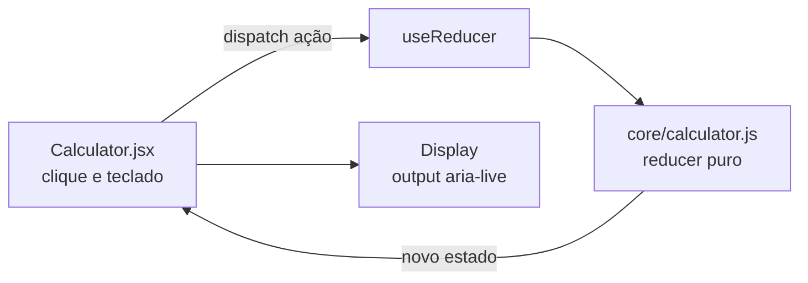
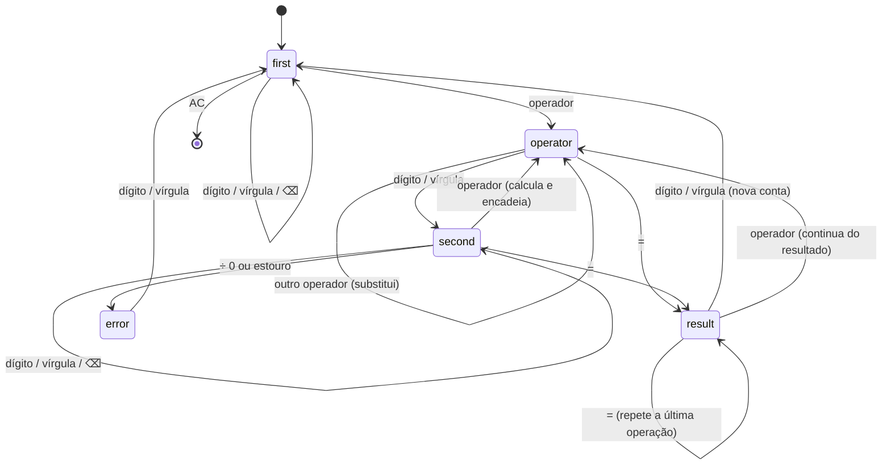

# Arquitetura alvo — Calculadora (calcAPP)

## 1. Visão C4

| Nível | Elemento | Descrição |
|---|---|---|
| Contexto | Pessoa → calcAPP | SPA estática, sem back-end e sem dados pessoais |
| Contêiner | SPA React 18 (CRA 5) | Hospedada de graça no GitHub Pages ou Vercel |
| Componentes | `App` → `Header`, `Calculator`, `Footer`; `Calculator` → `Display`, `Button` | `Calculator` só despacha ações para a FSM |



## 2. Estrutura de pastas

```
src/
├── core/
│   ├── calculator.js        (novo) FSM pura: reducer, compute, formatNumber, keyToAction
│   └── calculator.test.js   (novo) 20 testes unitários
├── main/Calculator.jsx      (reescrito) componente de função com useReducer + teclado
├── components/              Button, Display (acessíveis), Header (aria-pressed), Footer
├── App.jsx                  tema com preferência do sistema + localStorage
└── index.js                 React 18 (createRoot)
```

## 3. Modelo de estado (máquina de estados finita)

Estado: `{ phase, display, accumulator, operator, lastOperator, lastOperand, error }`. O visor é **sempre string** (fonte única de verdade); números só existem dentro de `compute`.



Regras numéricas:

- **Precisão:** resultado arredondado a 12 algarismos significativos (`toPrecision(12)`), o que corrige o erro de ponto flutuante IEEE 754 (0,1 + 0,2 = 0,3).
- **Faixa:** acima de 10¹² ou abaixo de 10⁻⁹, notação científica; `Infinity` vira erro "Resultado muito grande".
- **Entrada:** no máximo 12 algarismos.

## 4. Contrato de teclado

| Tecla | Ação |
|---|---|
| `0`–`9` | Dígito |
| `,` ou `.` | Vírgula decimal |
| `+` `-` `*` `/` (e `x`) | Operador |
| `Enter` ou `=` | Igual |
| `Backspace` | Apagar último dígito |
| `Esc` ou `Delete` | Limpar tudo (AC) |

## 5. Decisões de arquitetura (ADR)

### ADR-001 — FSM pura fora do React

- **Decisão:** toda regra em `core/calculator.js` como função `(estado, ação) → estado`, usada com `useReducer`.
- **Consequência:** 20 testes unitários rodam sem renderizar nada; a UI fica só com apresentação e eventos.

### ADR-002 — React 18 e react-scripts 5

- **Decisão:** atualizar de CRA 4 / React 17 para CRA 5 / React 18, removendo `--openssl-legacy-provider`.
- **Consequência:** roda em Node 18+ sem flags. A regra de lint `react-app/jest` foi retirada porque o `eslint-plugin-jest` resolvido na instalação atual quebra o build; os testes continuam rodando no Jest normalmente.

### ADR-003 — Clique do mouse não rouba o foco

- **Decisão:** as teclas da calculadora usam `onMouseDown` com `preventDefault`.
- **Consequência:** quem clica em "3" e aperta Enter recebe "=" em vez de repetir o "3"; quem navega por Tab continua focando e acionando as teclas normalmente.

## 6. Fora do escopo

- Porcentagem, troca de sinal, memória (M+/M−) e histórico de contas.
- Migração do CRA para Vite (recomendada em ciclo próprio).
